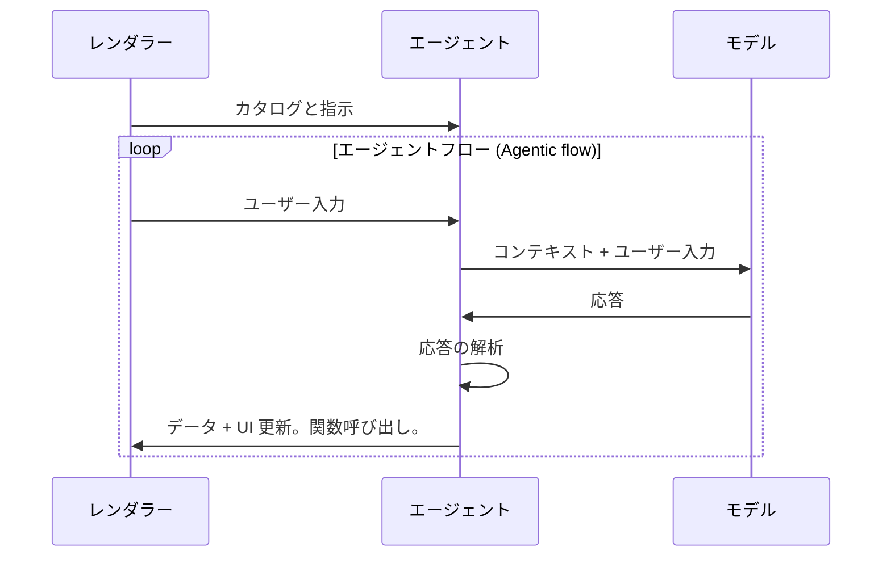
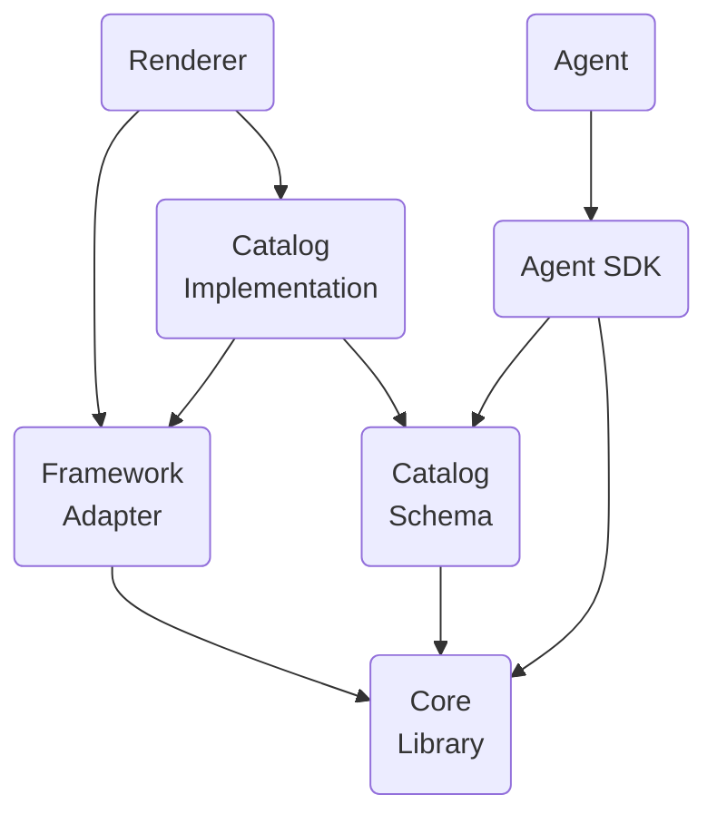

# 用語集

**レンダラーとエージェント間の A2UI プロトコル:**

A2UI プロトコルは、**エージェント**と**レンダラー**の間の会話を定義します:

1. **レンダラー**は、自身の **UI 機能**を A2UI カタログのセットとして、その使い方の**指示**とともに送信します。
2. その後、**エージェント**は次のループを繰り返します:
    - 受け取ったカタログに基づき、描画する **UI** と呼び出す**関数**を送信します
    - レンダラーから**ユーザー入力**を受け取ります
    - UI に表示される**データ**を更新します

**エージェントとモデル:**

レンダラーへの応答を生成するために、エージェントはモデルへリクエストを送信します。モデルは次のいずれかになり得ます:

- ほとんどの場合はリモートまたはローカルの LLM
- より複雑なオーケストレーションにおける別のエージェント
- 主にテスト用に使われる決定論的（deterministic）エンジン

**やり取りの概要:**

**A2UI SDK:**

A2UI チームは、複数の言語およびフレームワーク向けに 2 種類の SDK を提供しています:

- **Agent SDK**: レンダラーやモデルとのやり取りにおけるエージェント側をセットアップします。
- **Framework adapter SDK（別名 renderer SDK）**: エージェントとのやり取りにおけるレンダラー側をセットアップし、受信メッセージを処理します。

**この用語集の分類:**

以下の用語は 3 つのカテゴリに分類されています:

- **A2UI プロトコル用語**: レンダラーとエージェント間のやり取りに関する用語です。
- **A2UI エージェント用語**: エージェントアーキテクチャおよび Agent SDK に関する用語です。
- **生成 UI 用語**: 一般的な生成 UI の概念に関する用語です。

## A2UI プロトコル用語

A2UI プロトコルで必要となる用語です。

### A2UI エージェントと A2UI レンダラー

このプロトコルは **AI を活用するエージェント**向けに設計されていますが、決定論的なエージェントでも同様に動作します。たとえば、エージェントが事前に用意された A2UI UI を返すこともできます。

エージェントがステートレス（stateless）である場合、またはカタログの保持を保証しない場合、レンダラーはすべてのメッセージとともにカタログを送信する必要があります。

一部のエージェントは事前定義されたカタログを使用するため、レンダラーはそのカタログをサポートするか、アダプターを使用する必要があります。

### GenUI コンポーネント

エージェントが使用することを許可された UI コンポーネントです。例: date picker、carousel、button、hotel selector。

### Catalog（カタログ）

1. 項目化されたレンダラー機能です:
    - エージェントが UI を生成するために使用できるコンポーネントの一覧
    - レンダラーまたはエージェントが呼び出せる関数の一覧
    - スタイルとテーマ
2. それらの機能の使い方に関する説明です。

ユースケースに応じて、カタログのコンポーネントはドメインへの特化度が低いものから高いものまであります:

- **特化度が低いもの**:

    ボタン、ラベル、行、列、オプションセレクターなどの基本的な UI プリミティブ。

- **特化度が高いもの**:

    `HotelCheckout` や `FlightSelector` のようなコンポーネント。

### Basic catalog（基本カタログ）

A2UI をすばやく使い始めるために A2UI チームがメンテナンスしているカタログです。

[basic catalog](../../../specification/v0_9_1/catalogs/basic/catalog.json) を参照してください。

### Catalog transformer（カタログトランスフォーマー）

システムプロンプトの指示が生成される前、またはペイロード検証スキーマがコンパイルされる前に、元の **カタログ** をフィルタリング・適合・変更するルールセットです。

#### カタログトランスフォーマーが必要な理由

カタログはレンダラーがサポートするすべてのコンポーネントと関数を指定しますが、エージェントは多くの場合、それを刈り込んだり制限したりする必要があります:

- **コンテキストウィンドウの最適化**: カタログには数十個のコンポーネントや関数を定義できます。それらすべての JSON スキーマをモデルのシステムプロンプトに注入すると、コンテキストウィンドウのトークンを消費し、プロンプトのレイテンシが増加し、推論コストが高くなります。刈り込み（pruning）トランスフォーマーは、エージェントのタスクに必要なコンポーネントだけを残します。
- **機能ガードレール**: 一部のワークフローやセキュリティロールでは、対話機能を制限する必要があります。たとえばゲストモードでは、表示用のカードやテキストは許可しても、フォーム入力や管理用コンポーネントは許可しないといった制御が考えられます。
- **モデルシグネチャの削減**: 関数ルールや検証チェックを刈り込むことで、小型モデル向けのコンパクトなプロンプト指示を生成できます。

#### カタログトランスフォーマーの例

- `ComponentPruningTransformer`: 許可されたコンポーネント名のリストに基づいてカタログをフィルタリングするユーティリティクラスです。

- `FunctionPruningTransformer`: 許可された関数名のリストに基づいてカタログをフィルタリングするユーティリティクラスです。

### Capabilities object（機能オブジェクト）

利用可能なカタログのセットです。エージェントまたはレンダラーはこのセットを通じて自身がサポートするものを通知（advertise）し、相手側が何を送信してよいかを把握できるようにします。

たとえば、レンダラーが Basic、Hotels、Flights の各カタログをサポートしている場合、自身の機能オブジェクト内でそれらを通知します。

機能オブジェクトは、[A2UI メッセージ](#a2ui-message)としてではなく、トランスポートメタデータまたは初期化ペイロードを通じて交換されます。正確な配置場所はトランスポート固有です。

このオブジェクトは、プロトコルの以前のバージョンでは異なる名前で呼ばれています。v0.9 および v0.9.1 ではクライアントおよびサーバーのケーパビリティ（client and server capabilities）と呼ばれ、v0.8 ではクライアント側のスキーマのみが定義されています。

### Surface（サーフェス）

A2UI エージェントによって構築され、A2UI レンダラーによって管理される UI の領域であり、複数のコンポーネントで構成されます。サーフェスはネストできません。

### A2UI message（A2UI メッセージ）

エージェントとレンダラーの間のメッセージです。

プロトコルはストリーミングをサポートしているため、メッセージは完了済み（完全に配信された状態）または未完了（部分的に配信された状態）になり得ます。完了済みメッセージは、正常完了（正常に配信された状態）または中断（技術的な問題により配信が停止した状態）のいずれかです。

[データフローガイド](data-flow.md) を参照してください。

### Agent turn（エージェントターン）

エージェントがユーザー入力の待機を開始するまでに送信する一連のメッセージです。

### Data model（データモデル）

レンダラーとエージェントの間で共有され、双方から更新可能な、監視可能（observable）で階層的な JSON 風オブジェクトです。各サーフェスは独自のデータモデルを持ちます。

コンポーネントはデータモデルのノードにバインドでき、それらの値が変更されたときに自動的に更新されます。

データモデルは双方向同期を提供します。ユーザー操作を状態オブジェクトとしてキャプチャしてエージェントに送信し、同時にエージェントがデータの更新を UI にプッシュし直せるようにします。

[データバインディングガイド](data-binding.md) を参照してください。

### Data reference（データ参照）

コンポーネント定義において、データモデル内のパスまたは値のいずれかによって解決されるデータ要素への参照です。

[基本カタログの例](../../../specification/v0_9/catalogs/basic/catalog.json#L23) を参照してください。

### Function（関数） 

宣言された引数シグネチャと戻り値の型を持つ、カタログで定義された名前付きの操作です。関数を使うことで、エージェントとレンダラーの間で生の実行可能コードを送受信することなくロジックを実行できます。

関数はカタログ内で定義され、レンダラーまたはエージェントのいずれかで実行できます:

- **Renderer function（レンダラー関数）**: **レンダラー**上で実行される関数です。レンダラー関数は、値のフォーマット、入力フィールドの検証、ナビゲーション、ローカル UI 状態の制御といったクライアント側のタスクを処理します。また、エージェントがレンダラーに関数の実行を要求することもできます（たとえば、通知の表示やデバイスフィードバックのトリガーなど）。
- **Agent function（エージェント関数）**: **エージェント**上で実行される関数です。UI がサーバー側のロジック（在庫の確認、データベースのクエリ、認証情報の検証など）を必要とする場合、レンダラーはエージェントに関数の実行と結果の返却を要求します。

A2UI の関数は LLM のツール（tool）とは異なります:

| 項目           | A2UI 関数                                                                    | LLM ツール呼び出し                               |
| -------------- | ---------------------------------------------------------------------------- | ------------------------------------------------ |
| 実行主体       | A2UI レンダラー（レンダラー関数の場合）またはエージェント（エージェント関数の場合）。 | UI 外部のモデルホストまたはエージェント環境。    |
| タイミング     | UI 描画中、ユーザー操作時、またはターン間のリクエストとして実行。             | モデル応答の生成前または生成中。                 |
| 目的           | UI ロジック: 検証、フォーマット、クライアントアクション、アプリ操作。         | モデルの推論、Web 検索、データベース検索。       |
| 定義           | 引数と戻り値のシグネチャとともに A2UI カタログ内で宣言される。               | モデルに渡されるツール定義（tool definition）内で宣言される。 |
| 状態へのアクセス | サーフェスのデータコンテキスト、ローカル UI 状態、またはカタログメソッドに限定。 | 外部ツール、API、サービスに限定。                |

エージェントとレンダラーの間で関数がどのようにルーティングされ実行されるかの詳細については、[プロトコル仕様の A2UI における関数](../specification/v1.0-a2ui.md#functions-in-a2ui-content-execution) を参照してください。

### Function call（関数呼び出し）

一連の引数を用いたカタログ関数の呼び出しです。

関数呼び出しはいくつかの文脈で現れます:

- **動的値バインディング（Dynamic value bindings）**: レンダラーがレンダラー関数を呼び出して、コンポーネントのプロパティ値を動的に計算します（日付や通貨のフォーマットなど）。
- **検証ルール（Validation rules）**: レンダラーが送信前にユーザー入力を検証するためにレンダラー関数を呼び出します。
- **コンポーネント操作トリガー（Component interaction triggers）**: ユーザーがコンポーネントを操作したときにレンダラーがレンダラー関数を呼び出します（URL を開くなど）。
- **リモートプロシージャコール（RPC）**: エージェントがレンダラーにレンダラー関数の実行を要求するか、レンダラーがエージェントにエージェント関数の実行を要求します。

対象の関数が呼び出し元の環境に実装されている場合、関数呼び出しはローカルで実行されます。関数がエージェントとレンダラーの境界の反対側に存在する場合、呼び出しはプロトコルを介して通信されます。エージェントとレンダラーが同一プロセス内で動作するアーキテクチャ（スタンドアロンのデスクトップアプリケーションなど）では、これらの呼び出しはネットワークトランスポートなしでプロセス内で実行できます。

### Action（アクション）

UI コンポーネントに対するユーザーの操作によってトリガーされ、レンダラーからエージェントへディスパッチされるイベントです。

アクションは、操作（ボタンのクリックやオプションの選択など）が発生したことをエージェントに通知します。アクション名、レンダラーのデータモデルから抽出された関連する値、およびアクションの任意の説明とともに、ユーザーの意図を伝えます。

アクションは、会話のターンやビジネスロジックを駆動するためにエージェントへ伝えられるユーザーの意図を表します。これに対し、コンポーネントの操作がエージェントに通知することなく直接動作をトリガーする場合（URL を開く、クライアント側で計算を実行するなど）は、アクションをディスパッチするのではなく[関数呼び出し](#function-call)を実行します。

[アクションの詳細ガイド](actions.md) を参照してください。

## A2UI エージェント用語

エージェントアーキテクチャと Agent SDK を説明するために使われる用語です。

### A2UI tag（A2UI タグ）

モデルからエージェントへのメッセージにおいて、モデルのテキスト出力内の A2UI ペイロードブロックの境界を示す `<a2ui-json>` や `<a2ui>` などの区切りタグです。

1 回のモデルのターンには会話テキストと構造化された UI ブロックが混在し得るため、A2UI タグは各 UI ブロックの開始位置と終了位置を示します。

### Inference format（推論フォーマット）

モデルからエージェントへのメッセージにおける構造化された UI ブロックのフォーマットです。たとえば JSON、[Express DSL 構文](https://github.com/a2ui-project/a2ui/tree/main/python/a2ui_agent/src/a2ui/inference_formats/experimental/express)、または Elemental HTML タグなどがあります。

### モデルからエージェントへの応答解析フェーズ

**Tag unwrapping（タグのアンラップ）:**

応答解析の最初のフェーズ（`unwrap`）です。パーサーがモデルの応答から開始および終了の **A2UI タグ**をスキャンし、会話テキスト（例: _「要約は次のとおりです:」_）とタグで囲まれた生の UI ブロックとを分離します。

**Compilation（コンパイル）:**

応答解析の 2 番目のフェーズ（`compile`）です。アンラップ時に抽出された生の UI ブロック（標準 JSON、Express DSL 構文、または Elemental HTML タグ）を解析・逆コンパイルし、`createSurface` や `updateDataModel` などの標準的な A2UI プロトコルペイロードへと変換します。

### エージェントアーキテクチャ

A2UI エージェントはいくつかの方法で構築できます:

- **同一プロセスまたはサーバー側**:

    エージェントとレンダラーが、クライアント側アプリケーションの 1 つのプロセス内に共存する場合があります。例: デスクトップの Flutter アプリケーション。

    あるいは、レンダラーが UI を表示するマシン上にあり、エージェントが別のマシン（サーバー）上にある場合もあります。

- **オーケストレーターエージェント**:

    中央のオーケストレーターが、ユーザーと複数の専門サブエージェント間のやり取りを管理します。オーケストレーターは同一プロセス内にもサーバー上にも配置できます。

- **Pulling / pushing**:

    エージェントはレンダラーからのメッセージやリクエストを待機することも、レンダラーへプッシュすることもできます。

- **Stateful / stateless**:

    エージェントは状態を保持することも、ステートレス（stateless）にすることもできます。

- **他のプロトコルとの併用**:

    A2UI は他のプロトコルと組み合わせて使用できます。たとえば、エージェントが MCP サーバーや A2A サーバーを兼ねることができます。

- **その他**:

    上記の選択肢のカスタムバリエーションも可能です。

### 推奨されるコード構成

エージェントとレンダラーの機能は、個別に開発して再利用できるレイヤーで構成されます:

- **Core library（コアライブラリ）**:

    カタログを記述し、エージェントとやり取りするために必要なプリミティブのセットです。

    たとえば、[JavaScript web core library](../../../typescript/web_core/README.md) を参照してください。

- **Catalog schema（カタログスキーマ）**:

    JSON 形式によるカタログの定義です。

    たとえば、[basic catalog schema](../../../specification/v0_9_1/catalogs/basic/catalog.json) を参照してください。

- **Agent SDK**:

    エージェントとモデルおよびレンダラーとのやり取りを実装するコードです。

- **Framework adapter（または renderer SDK）**:

    具体的なフレームワーク上でエージェントの指示を実行するコードです。例:
    - JavaScript のコアとカタログは、Angular、Electron、React、Lit の各フレームワークに適合させることができます。
    - Dart のコアとカタログは、Flutter や Jaspr の各フレームワークに適合させることができます。

    [Angular adapter](../../../renderers/angular/README.md) を参照してください。

- **Catalog implementation（カタログ実装）**:

    特定のフレームワーク向けのカタログスキーマの実装です。

    例:
    - [基本カタログの Angular 実装](../../../renderers/angular/src/v0_9/catalog/basic) を参照してください。

## 生成 UI 用語

A2UI プロトコルでは必須ではありませんが、生成 UI の文脈で一般的に使われる用語です。

### GenUI の既知のパターン

- **Chat（チャット）**:

    生成された UI の断片が時間順に並び、ユーザー入力と混ざりながら縦スクロール領域に 1 つずつ表示されます。

- **Canvas（キャンバス）**:

    エージェントと共同作業するための空間です。

- **Dashboard（ダッシュボード）**:

    生成された UI の断片が時間順ではなく意味によって整理され、ユーザーが期待する場所にピン留め（pinned）された状態で維持されます。

- **Wizard（ウィザード）**:

    特定のタスクに必要な情報を収集するために、生成された UI の断片が 1 つずつ順番に表示されます。

### NoAI 情報

クレジットカードの詳細など、**AI がアクセスできない情報**として分類される情報です。

どの情報を AI からアクセス不可にするかはアプリケーションの所有者が決定し、その答えは**文脈によって異なります**。たとえば、あるプロダクトでは病歴を決して AI に渡してはなりませんが、別のプロダクトでは診断を支援するために AI が病歴に依存します。

この用語が GenUI の文脈で重要なのは、エンドユーザーが自分の入力のうちどれが AI に渡る可能性があり、どれが渡らないのかを**明確に確認したい**ためです。
